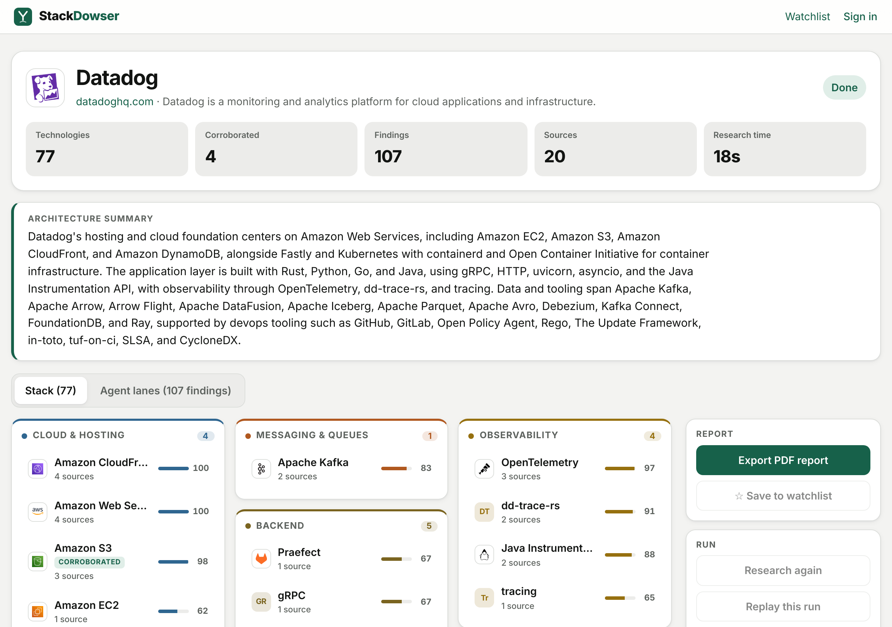
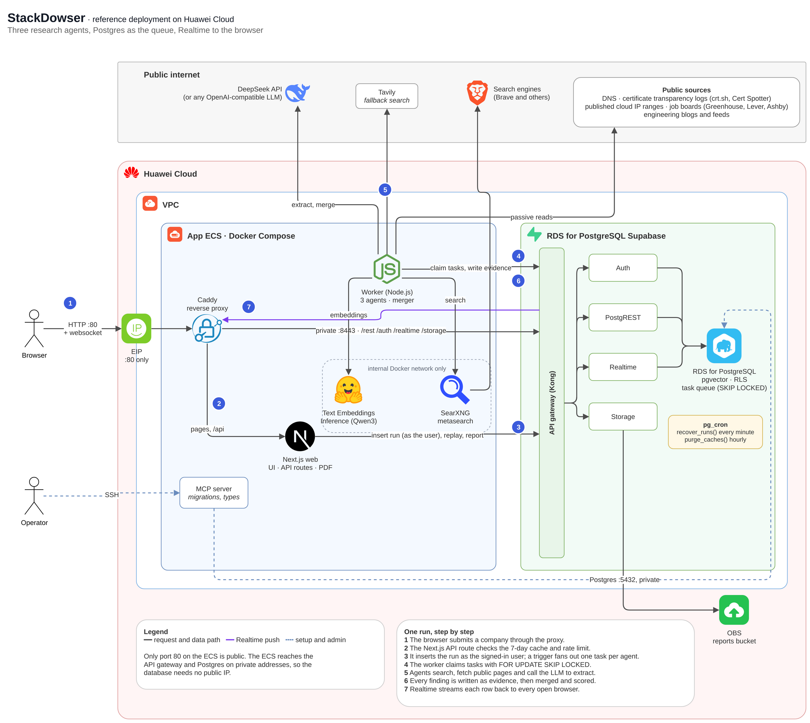

# StackDowser

A demo application for testing the Supabase feature of **Huawei Cloud RDS for PostgreSQL**,
which is still in its test phase. It is a real workload rather than a feature checklist: a
Next.js app and a Node.js worker on an ECS that use Auth, the REST API, RLS, Postgres
functions, Realtime, Storage, pgvector and pg_cron through one RDS Supabase application.

What the app does: you enter a company name. Three agents then read public sources, such
as DNS records, job boards and engineering blogs, and work out which technologies the
company uses. Each technology comes with the quote and the link it was found in. On the
reference deployment a run takes 20 to 60 seconds.



> Built with Claude Opus 5.5 in about 5 hours, from the spec to the deployed
> demo. Every migration and schema check went through the Supabase MCP setup from Huawei's
> guide, and it held up well. The rough edges are in
> [docs/deploy-huawei-cloud.md](docs/deploy-huawei-cloud.md).

See the [demo video](docs/demo.mp4) (49 seconds).

## Architecture



- **One public port.** Only port 80 on the ECS is open. Caddy serves the app and passes
  Supabase traffic (`/rest`, `/auth`, `/realtime`, `/storage`) to the API gateway over the
  private network. The gateway and the database have no public IP.
- **Postgres is the job queue.** Each run creates one task per agent. Workers pick tasks
  with `FOR UPDATE SKIP LOCKED`, so two workers never take the same one. When the last
  task finishes, the run moves on to the merge step.
- **Internal services stay internal.** SearXNG (search) and Text Embeddings Inference
  (embeddings) run only on the Docker network, with Tavily as the search fallback. The LLM
  can be any OpenAI-compatible API; this deployment uses DeepSeek.

## Supabase features used

| Feature | How the app uses it | On RDS |
| --- | --- | --- |
| Auth | Email and password sign-in. Runs are inserted with the user's own JWT. | Works. |
| REST API and RLS | Research is readable by everyone, a watchlist only by its owner, and a user can only insert runs as themselves. | Works. Tables need explicit grants to `service_role` (`0013`), and the schema cache has to be reloaded by hand after DDL. |
| Postgres functions | `claim_task()` and `finish_task()` make Postgres the task queue; `similar_companies()` ranks stacks by vector distance. | Works. Functions that use pgvector have to be `security definer` (`0015`). |
| Realtime | `postgres_changes` on `evidence`, `agent_tasks` and `research_runs` streams a run to every open browser. | Works, through the proxy on the ECS. |
| pgvector | An HNSW index on stack embeddings, plus name matching against the technology dictionary. | Works, with types qualified as `extensions.vector`. |
| pg_cron | `recover_runs()` every minute, `purge_caches()` hourly. | Works once `cron.use_background_workers` is on (off by default, so every run fails with "connection failed"). |
| Storage | A private `reports` bucket for PDF exports, shared by signed link. | Uploads fail with `403 VirtualHostDomainRequired`, so the app sends the PDF straight to the browser. |

[docs/deploy-huawei-cloud.md](docs/deploy-huawei-cloud.md) has the full setup and every
workaround.

## How a run works

| Agent | Reads | Finds |
| --- | --- | --- |
| Web Footprint | DNS (MX, TXT, NS, CNAME, A), certificate transparency logs, published cloud IP ranges, the homepage | Hosting and cloud per host, CDN and WAF, email provider, SaaS domain verifications, frontend framework |
| Job Postings | Public Greenhouse, Lever and Ashby boards, the careers page, and web search at the same time (results that robots.txt disallows, such as LinkedIn, are dropped) | Languages, frameworks, databases and infrastructure in job requirements |
| Engineering Blog | The blog's RSS/Atom feed or sitemap, then web search | What runs in production, what was migrated to and away from |

- **Agents are fixed pipelines**, not tool-calling loops: probe, search, fetch, filter,
  extract, with the LLM called at fixed steps. Each has a budget of 60 seconds, 5 searches,
  12 page reads and 8 LLM calls.
- **Every extraction is checked verbatim.** The quoted snippet has to appear in the fetched
  page, or the finding is dropped.
- **A merger** maps each name to the technology dictionary: an alias match, else an
  embedding within 0.9 cosine similarity, else the LLM proposes a new entry. It drops the
  company's own products and works out whether each technology is in use, being hired
  for, or migrated away from.
- **Replays** re-insert a finished run's evidence with its original timing, so Realtime can
  be tested without hitting the network again.

## Passive only

StackDowser reads public sources and nothing else. It never port-scans, brute-forces subdomains or tries to log in. Subdomains found in
certificate logs are resolved in DNS, never fetched. The fetcher sends its own user agent,
respects robots.txt and skips pages behind a login. Public signals go stale, so treat the
output as leads to confirm.

## Run it

You need a Supabase project with `vector` and `pg_cron` available, an API key for an
OpenAI-compatible LLM, and a machine with about 4 vCPU and 8 GB of RAM (the embedding
model alone takes 2.5 GB).

1. Apply `supabase/migrations/` in order, with the Supabase CLI, the SQL editor or an MCP
   server. `0009_cron.sql` needs `pg_cron` in `shared_preload_libraries`.
2. Copy `.env.example` to `.env` and fill it in. `LLM_BASE_URL`, `SEARCH_PROVIDERS` and
   `EMBEDDINGS_URL` choose the providers.
3. Start it and embed the technology dictionary:

   ```sh
   docker compose up -d --build
   docker compose exec worker npm run embed:technologies
   ```

4. Create a user in Supabase Auth, open port 80 and sign in.

## Development

```sh
npm install
npm run lint && npm run typecheck && npm test
sh supabase/tests/run.sh      # migrations and the task flow on plain Postgres; needs Docker
```

Unit tests cover the name normalizer, the scoring formula, the verbatim check, the CNAME
and IP-range matchers and the job board parsers, against recorded responses.

```
web/                  Next.js: UI, API routes (start run, replay, delete, PDF), logos
worker/               agents, merger, search / LLM / embedding clients
packages/db/          shared zod schemas and generated database types
supabase/migrations/  numbered SQL files, applied in order
supabase/tests/       migration and task-flow tests
searxng/settings.yml  search engines for the internal SearXNG
proxy/Caddyfile       the only public entry point
docs/                 Huawei Cloud deployment notes, architecture diagram
```

## Credits

Technology logos come from [Simple Icons](https://simpleicons.org) (CC0) and, for brands
Simple Icons doesn't carry, from the [Iconify "logos" set](https://github.com/gilbarbara/logos)
(CC0). The diagram uses Huawei Cloud's product icons. All logos are trademarks of their
owners and are used only to name their products.

## License

MIT, see [LICENSE](LICENSE). The logos and icons above keep their own licenses and
trademarks.
